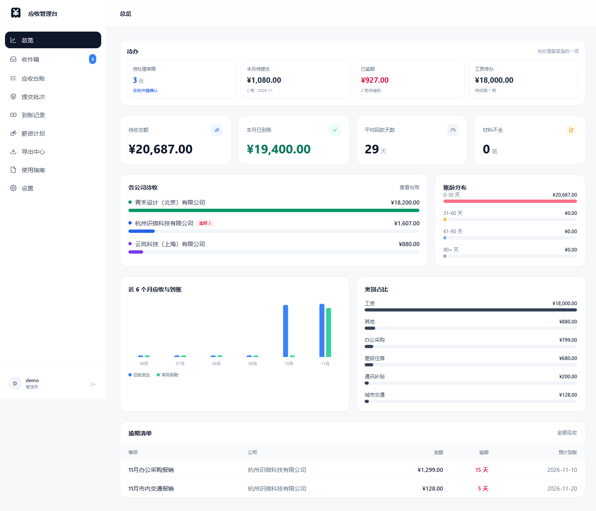
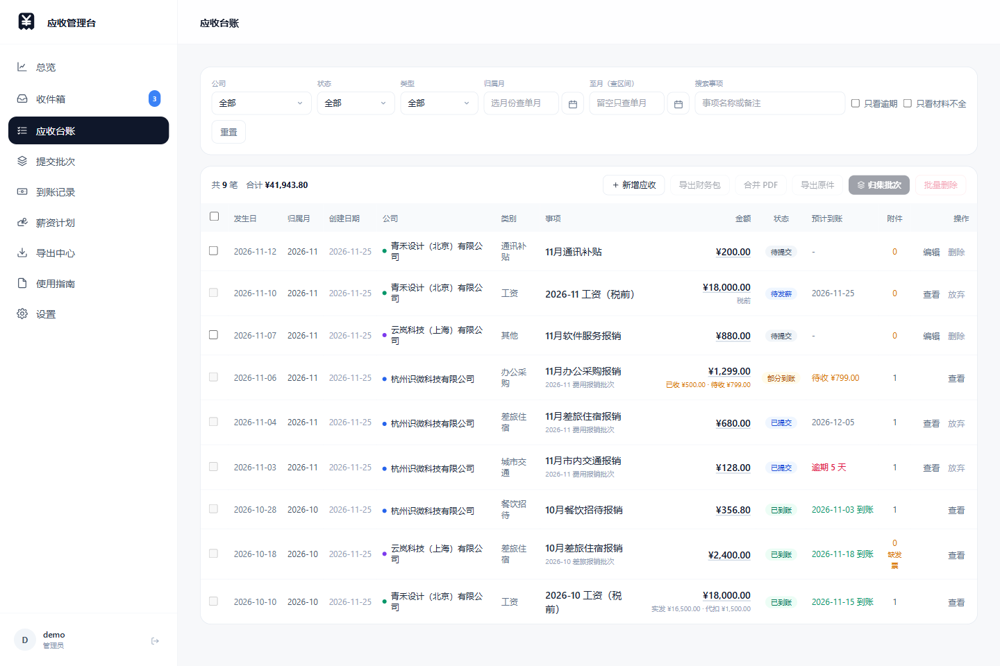
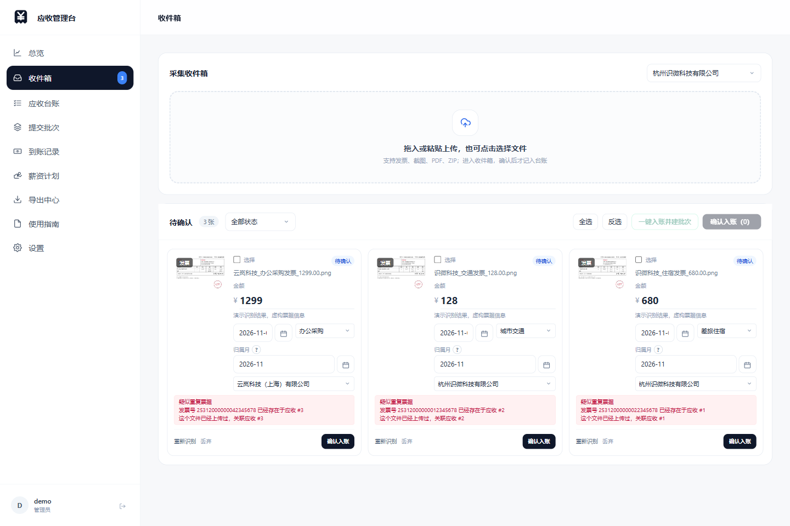
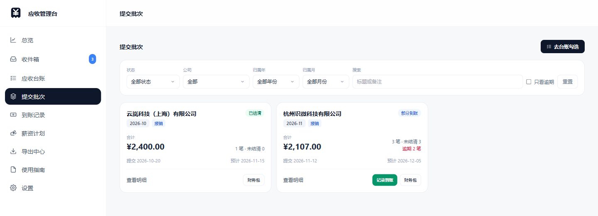

# 个人应收与报销管理台 (Reimburse AI)

把「公司欠我的钱」管清楚：报销、工资、奖金、补贴都能记。每笔钱知道属于哪家公司、走到哪一步、逾期多久、材料够不够，并能一键打包交给财务。

这不是个人记账工具——不记录个人消费、预算与账户余额。

## 界面预览

以下截图来自虚构演示账本：公司名、税号、发票号与金额均为示例数据，不含真实票据。

### 总览



### 应收台账



### 采集收件箱



### 提交批次



## 核心能力

1. **采集与 AI 识别**
   - 截图后 `Ctrl+V` 粘贴，或拖入图片、PDF、OFD、ZIP；单文件 25MB，单次最多 30 个。
   - 上传即入收件箱，后台并发识别；同用户相同文件复用识别结果。
   - 标准发票、全电发票、铁路电子客票、通行费汇总单走本地 PDF 文本层模板，毫秒级解析、不经 AI；其余版式与截图走用户配置的多模态模型。
   - 银行转账「汇入汇款」截图若附言含多条费用明细，AI 会拆出每条明细的费用项、归属月与金额，给出「附言拆单核销」方案，一笔到账分摊到多笔已提交应收。
   - 金额始终可人工修改、可看原图；模型没给金额时不会用候选值顶替。

2. **对公应收台账**
   - 公司、类别、归属月、发生日、金额、已收、核销差额、状态、预计到账日。
   - 归属月独立于发生日期，确认时可改，已提交后锁定。
   - 状态：待提交、已提交、部分到账、已到账、被驳回、已放弃；只有待提交和被驳回可归集。
   - 待收 = 应收金额 − 已收金额 − 核销差额（工资代扣等确认不再追收的部分）。
   - 逾期不单独存状态，由「今天 > 预计到账日且未结清」实时计算。
   - 支持批量改归属月、批量软删待提交/被驳回记录。

3. **提交批次**
   - 按公司勾选同一归属月的应收归集为批次；草稿批次可增删应收，已提交未到账可撤回提交后调整。
   - 收件箱「一键入账并建批次」：勾选草稿后一次完成确认入账、按同一归属月建批次并提交，省去多步操作。
   - 提交时按公司「每月打款日 + 账期」推算预计到账日。
   - 批次「记录到账」支持整批按余额核销，也支持部分到账——勾选实际到账的应收并填各自金额，其余保持未结清。

4. **到账核销**
   - 一笔到账可分摊到多笔应收，分摊合计必须等于到账金额，单笔不得超过待收余额。
   - 工资口径特殊：应收记税前（应发），发薪后按实发登记，差额记代扣；工资不进批次，批次到账会跳过工资项。
   - 工资到账截图按备注月份、最早欠发顺序与历史实发推断核销；银行附言多条明细走上述拆单核销。
   - 删除到账会回退应收与批次状态。

5. **薪资计划**
   - 按公司配置税前月薪、发薪日、生效/停发日期；发薪日按「次月 x 号」理解。
   - 打开应用或手动调用同步接口补齐缺失月份，生成即「待发薪」（已提交），同一公司同一归属月不重复。
   - 不上后台定时任务。涨薪通过结束旧计划、新建新计划实现；补发、年终奖可手工录入。

6. **统计看板**
   - 待收总额、逾期金额、本月到账、平均回款天数；各公司待收、账龄分布、近 6 个月趋势、类别占比、逾期清单。
   - 待办：未确认草稿、本月待提交、已逾期、待核销或待生成的工资。

7. **财务交付**
   - 财务报销包 ZIP：封面 PDF、明细 Excel、合并票据 PDF、原件与截图凭证。
   - 也可按应收、批次或归属月只打包原始文件。
   - 导出留快照、文件哈希与下载记录，可追溯、可重新下载。
   - 应用内在线预览图片与 PDF（OFD 不支持预览）。

8. **多用户与安全**
   - JWT + argon2id 口令哈希，登录限流与失败封禁，一次性签名下载。
   - 所有查询强制带 `user_id`；成员账本彼此隔离，管理员只能管理账号状态，不能读取他人账本。
   - 默认只创建普通成员，创建管理员需二次确认；支持停用（会话立即失效）与软删除。
   - 仅 `ALLOW_REGISTRATION=1` 时开放自主注册；CORS 默认关闭。

9. **Agent 令牌**
   - 用户在「设置 → Agent 令牌」为自己签发 `ragt_` 前缀令牌，明文只在签发时显示一次，只存 SHA-256；重新签发后旧令牌立即失效。
   - 请求头 `Authorization: Bearer ragt_...`，令牌只作用于签发用户账本。
   - 范围：`capture`（采集、草稿、确认、核销到账）、`ledger`（公司、类别、台账、批次、到账、看板、薪资计划、附件）、`export`（Excel、PDF、财务包、打包原件）。
   - 禁止用令牌管理账号、改密、签发/吊销令牌、读写 AI 密钥；可读取 AI 启用状态与模型名称。

## 环境变量

完整说明见 [`.env.example`](.env.example)。常用项：

| 变量 | 作用 | 默认 |
|---|---|---|
| `PORT` | 监听端口 | `8090` |
| `HOST` | 监听地址 | `0.0.0.0` |
| `EXPENSE_DATA_DIR` | 数据目录 | `<BASE_DIR>/data` |
| `EXPENSE_DB_PATH` | SQLite 路径 | `<DATA_DIR>/expense.db` |
| `EXPENSE_UPLOAD_DIR` | 附件存储目录 | `<BASE_DIR>/uploads` |
| `JWT_SECRET_KEY` | JWT 签名密钥（留空自动生成并持久化） | 空 |
| `ADMIN_USERNAME` / `ADMIN_PASSWORD` | 预设管理员，留空走向导 | 空 |
| `ALLOW_REGISTRATION` | 开放自主注册 | 关闭 |
| `ENABLE_API_DOCS` | 开放 `/docs` 等接口文档 | 关闭 |
| `CORS_ORIGINS` | 跨域白名单，逗号分隔 | 空（同源） |
| `CAPTURE_CONCURRENCY` | 后台识别并发数 | `4` |
| `CAPTURE_SYNC` | 同步识别（仅测试用） | 关闭 |
| `CJK_FONT_PATH` | 导出 PDF 的中文字体 | 自动探测 |

## 本地开发

```bash
python -m venv .venv
# Windows: .venv\Scripts\activate    Linux/macOS: source .venv/bin/activate
pip install -r requirements.txt
python run.py
```

默认访问 `http://localhost:8090`，首次打开引导创建管理员。数据库与附件落在项目根目录的 `data/`、`uploads/`。

也可本地用 Docker 构建（绑定 `127.0.0.1:8092`）：

```bash
docker compose -f docker-compose.local.yml up -d --build
```

## 生产部署

生产为 Linux + Docker Compose，宿主 `8092` → 容器 `8090`，反向代理对外。持久化数据挂载：

- `/data/reimburse-ai/data` → 容器 `/app/data`（SQLite 与系统配置）
- `/data/reimburse-ai/uploads` → 容器 `/app/uploads`（原件与导出）

发布流程：推送 `v*` 标签触发 Woodpecker CI 的 tag 流水线，构建镜像推送到内网 Registry 并部署；日常 push `main` 不触发部署。数据库变更由 Alembic 管理，应用启动时自动执行 `alembic upgrade head`；3.4.0 之前的兼容逻辑冻结在 `app/services/migrations.py`，不再扩充。

## AI 识别配置

在「设置 → AI 识别」填写任意 OpenAI 兼容的多模态接口：接口地址、API Key、模型名称（如 `gpt-4o-mini`、`qwen-vl-max`），可选自定义提示词。不配置也能用——截图保留原图，金额手工填写。图片会发送到你配置的模型服务商，请自行评估隐私边界。

## 备份与恢复

```bash
python scripts/backup.py
```

使用 SQLite backup API 备份数据库，连同 `uploads/` 与密钥打包到 `data/backups/`，默认保留最近 14 份。容器内可执行 `docker exec reimburse-ai python scripts/backup.py`。恢复时停容器，解压备份覆盖 `data/` 与 `uploads/` 后重启。

## 项目结构

```
app/
  main.py                  API 路由与业务编排
  models.py                数据模型（金额均为整数分 *_cents）
  schemas.py               请求模型
  database.py              SQLite 引擎与会话
  alembic/                 数据库版本迁移（alembic.ini）
  services/
    ai_service.py          多模态识别与 JSON 归一化
    ai_config.py           用户/系统级 AI 配置
    extractor.py           标准票据 PDF 文本层本地模板
    capture.py             文件落盘、草稿识别、去重、确认
    reimbursement_match.py 到账附言拆单匹配（只产出建议）
    payroll_plans.py       薪资计划与按月补齐
    payroll_match.py       工资到账推断与分摊建议
    ledger.py              应收状态机与批次调整
    exporter.py            Excel、合并 PDF、财务包
    money.py               整数分与日期工具
    preview.py             在线预览与缩略图
    auth.py / auth_guard.py 认证、JWT、登录限流
    agent_tokens.py        Agent 令牌签发、哈希与范围
    download_tokens.py     一次性签名下载
    audit.py / migrations.py 审计与历史兼容层
  static/index.html        Vue 3 单页界面
tests/                     接口、状态机、到账与 Agent 故事测试
tests/fixtures/invoices/   可复用发票夹具
docs/USER_GUIDE.md         使用指南（应用内帮助的唯一正文）
docs/ROADMAP.md            改进路线图与历史决策
docs/screenshots/          README 界面截图（虚构演示数据）
skills/reimburse-ai/       对外 Agent 技能文档（唯一真源）
scripts/backup.py          备份脚本
```

## Agent 调用

其它 Agent 的完整用法见 [`skills/reimburse-ai/SKILL.md`](skills/reimburse-ai/SKILL.md)。签发令牌后用该用户身份访问：

```http
Authorization: Bearer ragt_...
GET /api/auth/me
```

`/api/auth/me` 返回 `auth_method`、令牌名称与范围。建议为 Agent 或故事测试单独建成员账号，只在该账本中操作；系统不会向生产库自动写入测试用户。

## 测试

```bash
python -m pytest -q
```

测试使用隔离临时库与上传目录，不触碰 `data/`、`uploads/` 或生产路径。故事测试用 `tests/fixtures/invoices/` 中的夹具在隔离用户账本中跑完整流程，不依赖在线 AI。夹具中的公司名、税号与发票号均为虚构示例。重新生成夹具：

```bash
python tests/fixtures/invoices/render.py
```

## 许可证

MIT
